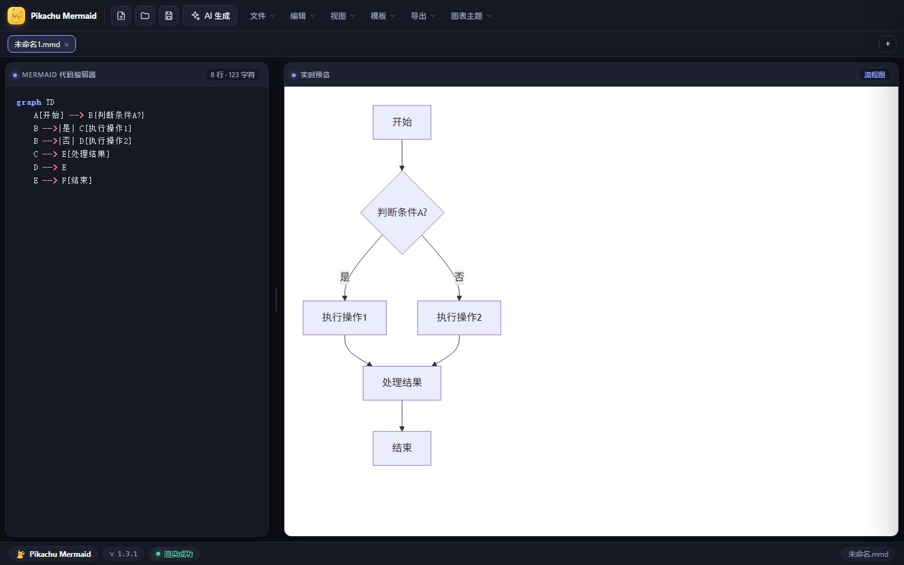

# Pikachu Mermaid

零依赖的 Mermaid 图表编辑器 —— **纯 Web 单文件方案**，浏览器打开即可用，无需 Python / PyQt / 任何安装。v1.3.2 在 AI 生成能力之上，进一步重排菜单结构、应用皮卡丘品牌图标并优化保存与标签页操作。



## ✨ 特性

| 功能 | 说明 |
|------|------|
| **AI 生成图表** | 描述需求自动生成 Mermaid 代码；7 种预设服务商 + 自定义 OpenAI 兼容接口；SSE 流式输出、一键替换/插入/复制、最近生成历史 |
| **菜单化工具栏** | 单行结构：皮卡丘品牌标识 + 新建/打开/保存/AI 快捷按钮 + 文件/编辑/视图/模板/导出/图表主题 6 组下拉菜单；点击外部或 Esc 自动收起 |
| **皮卡丘图标** | `Pikachu_Mermaid.ico` 用作品牌标识、AI 助手标题、状态栏标记与空预览态插画；仍是 PWA 应用图标 |
| **便捷操作** | 已有文件名时 `Ctrl+S` 直接保存，「另存为…」才弹窗；双击标签页可重命名；图标按钮带工具提示 |
| **本地 AI 代理** | 零依赖 Python 单文件，同源托管页面并转发 `/api/chat`；解决浏览器跨域，API Key 不进入前端 |
| 实时预览 | 编辑即渲染，200ms 防抖，图表类型自动识别，预览背景随主题自适应 |
| 语法高亮 | 关键词（蓝）、箭头（红）、注释（绿）、字符串/数字（彩色），零依赖实现 |
| 撤销 / 重做 | 自建历史栈（200 步上限），连续输入合并，`beforeinput` 统一记录（覆盖粘贴 / 中文输入法），`Ctrl+Z` / `Ctrl+Y` |
| 图表模板 | 默认 9 种（流程图/序列图/甘特图/类图/状态图/饼图/思维导图/象限图/雷达图），可按类型分组显示，可增删改、导入导出 JSON，localStorage 持久化 |
| 错误波浪线 | 渲染失败时在编辑器对应行标注红色波浪线，点击预览错误提示可跳转定位 |
| 主题切换 | 图表主题：default / neutral / dark / forest；**界面外观：深色 / 浅色**，两者相互独立 |
| 缩放 | 预览区放大 / 缩小 / 重置，`Ctrl+滚轮` 快速缩放 |
| 多文件标签页 | 多文档并行编辑，每标签独立撤销历史（切换标签保留，**不跨会话持久化**），草稿按标签整体恢复 |
| 大纲导航 | 自动解析 subgraph / section / participant 生成可点击目录，跳转对应代码行 |
| 全屏预览 | `Ctrl+Enter` 一键进入全屏演示模式 |
| 标签管理 | 单击切换标签，双击标签重命名 |
| 导出 PNG / SVG / PDF / MD | PNG 2x 超采样（背景可选主题/白色/透明）、SVG 序列化、PDF 走系统打印对话框（选"另存为 PDF"）、Markdown 导出含 mermaid 代码块 |
| 复制 Markdown / SVG | 一键复制 ```` ```mermaid ```` 代码块或 SVG 源码到剪贴板，方便粘贴到 Typora / 语雀 / Notion |
| 打开 / 保存 | 支持 `.mmd` / `.mermaid` / `.txt`，UTF-8 优先、GBK 自动兼容 |
| 草稿自动恢复 | 编辑内容每 0.5s 自动存入 localStorage，下次启动可恢复未保存内容（多标签整体恢复） |
| 错误定位 | 渲染失败时解析错误行号，点击提示即可跳转到对应行 |
| PWA 离线支持 | 提供 manifest + Service Worker，通过 http 服务访问时可"安装为应用"并离线使用 |
| 未保存提示 | 关闭 / 刷新页面时浏览器原生提示 |

## 🚀 使用方法

**在线使用（推荐）**

打开 👉 **https://yohoten.github.io/Pikachu_Mermaid/** （GitHub Pages 托管，无需安装任何东西，打开即用）

**本地方式（任选其一）**

| 方式 | 操作 | 说明 |
|------|------|------|
| 直接打开 | 双击 `index.html` | file:// 协议即可运行，无需服务器；PWA 安装与本地代理不可用 |
| 本地服务 | `python -m http.server 8000` → 访问 `http://localhost:8000` | 可启用 PWA 安装与离线功能 |
| AI 代理 | `python tools/ai_proxy.py --preset deepseek` → 访问 `http://127.0.0.1:8787` | 同源托管页面 + AI 转发，密钥不进浏览器（下文详述） |

**PWA 安装为应用（桌面化，可选）**

通过在线地址或本地服务访问后（须为 http/https，不能是 file://）：

1. Chrome / Edge 打开后，地址栏右侧会出现 **安装图标**（显示器+箭头），点击。（**关闭浏览器后执行该步骤，保证无其他标签页**）
2. 或点右上角 **⋮ 菜单 → 安装 Pikachu Mermaid**
3. 确认后即以**独立窗口**运行，桌面/开始菜单生成快捷方式
4. 安装后**完全离线可用**（Service Worker 已缓存全部资源），不再需要服务器，每次打开不再重复下载

**快捷键**（全局生效，焦点不在编辑器时同样可用；在 AI 输入框内 `Ctrl+Z` / `Ctrl+Y` 让给输入框自身）

| 快捷键 | 功能 |
|--------|------|
| `Alt+K` | 打开 / 关闭 AI 助手 |
| `Esc` | 关闭 AI 助手 |
| `Ctrl+Z` / `Ctrl+Shift+Z` / `Ctrl+Y` | 撤销 / 重做 |
| `Ctrl+S` | 保存（已有文件名时直接保存；新文件才询问文件名） |
| `Ctrl+O` | 打开 |
| `Alt+N` | 新建标签页（`Ctrl+N` 是浏览器保留快捷键，网页拦不住，故改用 `Alt+N`） |
| `Ctrl+Enter` | 全屏预览 / 退出全屏 |
| `Ctrl+滚轮` | 缩放预览 |
| `Tab` / `Shift+Tab` | 缩进 / 反缩进（选中多行时整块缩进） |

## 🤖 AI 生成图表

点击工具栏 **AI 生成**（或 `Alt+K`）打开右侧助手面板：输入需求 → 选择服务商 → 生成 → 应用到编辑器。

**AI 按钮是单一入口**：面板未打开时点它打开面板；已打开但描述为空时聚焦输入框；已有描述时点它直接生成；生成中点它则取消请求。按钮文字会随状态在「AI 生成 / 立即生成 / 取消生成」间切换，配色与其他工具栏按钮一致。在提示词输入框内按 `Ctrl+Enter` 也可直接生成。

### 预设服务商

| 预设 | 默认端点 | 默认模型 | 备注 |
|------|----------|----------|------|
| 本地代理（推荐） | `/api/chat` | `deepseek-flash` | 由 `tools/ai_proxy.py` 转发，浏览器端无需 API Key |
| DeepSeek | `https://api.deepseek.com/chat/completions` | `deepseek-flash` | 可改为 `deepseek-v4-pro` |
| 通义千问 | `https://dashscope.aliyuncs.com/compatible-mode/v1/chat/completions` | `qwen-plus` | 专属地域/工作空间需替换为对应域名 |
| 智谱 GLM | `https://open.bigmodel.cn/api/paas/v4/chat/completions` | `glm-4.5-flash` | 免费模型，适合试用 |
| Kimi | `https://api.moonshot.cn/v1/chat/completions` | `kimi-k3` | 可改为 `kimi-k2.6` |
| OpenAI | `https://api.openai.com/v1/chat/completions` | `gpt-5.4-mini` | Chat Completions 接口 |
| 自定义接口 | 手工填写 | 手工填写 | 任意 OpenAI 兼容 `/chat/completions` 端点（含自建网关、Ollama 兼容层等） |

模型名、接口地址均可在面板中直接修改；切换预设会恢复该预设的推荐值。系统提示词可在底部「系统提示词（高级）」中改成自己的规范。

### 输出处理

- 使用 `stream: true` 的 SSE 流式响应，按 token 实时显示；不支持流式的兼容端点会自动回退到整段 JSON 解析。
- 优先提取 ```` ```mermaid ```` 代码块；若模型没有加代码围栏，则从第一行图表声明开始截取，避免把寒暄写进编辑器。
- 「替换编辑器」会写入撤销栈，可用 `Ctrl+Z` 撤回；「插入光标处」在当前选区插入；「复制代码」直接复制纯 Mermaid 源码。
- 请求期间可点「取消」中止（`AbortController`）；网络/跨域/认证/限流错误会给出可操作的提示。
- 最近 20 条生成记录保存在本机，点击即可重新载入代码。

### 密钥与跨域

- 默认情况下 API Key **只保留在当前会话内存**，刷新即丢失；勾选「记住」会把密钥**明文**写入本机 `localStorage` —— 公共设备请勿勾选。
- 服务端是否允许浏览器直连取决于服务商的 CORS 策略。若遇到 `Failed to fetch`，请使用下面的本地代理，或把「自定义接口」指向自己的同源网关。
- 不要在公开托管的页面上填入真实密钥：任何访问者都能在浏览器端看到它。

## 🔁 本地 AI 代理（零依赖）

`tools/ai_proxy.py` 只用 Python 标准库，做两件事：同源托管静态页面；把 `POST /api/chat` 转发到上游并原样回传 SSE 流。密钥来自环境变量或命令行，**不会下发到浏览器**。

```bash
# 1) 设置密钥（以 DeepSeek 为例，密钥不进命令行历史）
export DEEPSEEK_API_KEY=sk-xxxxxx

# 2) 启动：同时托管页面 + AI 转发
python tools/ai_proxy.py --preset deepseek

# 3) 浏览器打开 http://127.0.0.1:8787 ，AI 面板选择「本地代理」
```

其他服务商的环境变量名：`DASHSCOPE_API_KEY`（通义）、`GLM_API_KEY`（智谱）、`MOONSHOT_API_KEY`（Kimi）、`OPENAI_API_KEY`（OpenAI）。也可用 `--upstream <完整地址> --model <模型名> --key <密钥>` 指向任意兼容接口；`--port` 改端口；`--no-ai` 只托管静态页面。

代理内置目录穿越防护、SSE 流式透传与上游错误映射，监听地址固定为 `127.0.0.1`，不会暴露到局域网。CORS 不再使用通配符：只接受本服务自己托管页面（同源 `Origin`）的请求，并直接拒绝第三方站点的 `/api/chat` 调用，避免本机密钥被别的网页盗用。

## 🚀 部署到 GitHub Pages（在线访问）

本项目已托管于**https://yohoten.github.io/Pikachu_Mermaid/**

若需更新线上版本：

```
1. git init && git add . && git commit -m "update"
2. 关联远程仓库：
   git remote add origin https://github.com/yohoten/Pikachu_Mermaid.git
   git branch -M main
   git push -u origin main
3. GitHub → 仓库 Settings → Pages
   - Source 选 "Deploy from a branch"
   - Branch 选 main / (root)
   - 保存后等待 1-2 分钟，即可访问 https://yohoten.github.io/Pikachu_Mermaid/
```

**PWA 在 GitHub Pages 的说明**
- GitHub Pages 提供 https，因此 Service Worker 可正常注册，**安装为应用 + 离线功能完全可用**
- manifest 与 sw.js 均使用相对路径，在 `/Pikachu_Mermaid/` 子路径下正常工作
- 更新代码后若线上仍显示旧版：浏览器 `Ctrl+F5` 强刷，或应用内会随 SW 更新自动刷新

## 📁 项目结构

```
Pikachu_Mermaid/
├── index.html             # 单文件应用（UI + 逻辑 + 模板 + AI 助手全部内嵌）
├── mermaid.min.js         # 本地 mermaid v11.16.1（离线可用，支持全部图表）
├── Pikachu_Mermaid.ico    # 应用图标（浏览器标签页 / 快捷键 / PWA）
├── icon-192x192.png       # PWA 图标（192px，安装必需）
├── icon-512x512.png       # PWA 图标（512px，安装必需）
├── manifest.webmanifest   # PWA 清单（安装为应用 / 离线）
├── sw.js                  # Service Worker（离线缓存，v6）
├── tools/
│   └── ai_proxy.py        # 可选：零依赖本地 AI 代理（同源托管 + SSE 转发）
├── LICENSE                # MIT
├── package.json           # 仅提供 npm test 入口，运行时零依赖
├── test/
│   ├── check.js           # 静态回归：JS 语法 / HTML 标签 / ID / 关键功能 / README 与实现一致性
│   ├── func_test.js       # 行为回归：highlight 错误行、renderOutline 解析（提取真实函数执行）
│   ├── e2e_browser.py     # 可选：playwright 端到端回归（缺失时自动跳过）
│   ├── ui_smoke.py        # 可选：零依赖无头浏览器 UI 巡检入口
│   └── ui_smoke_harness.js # 注入页面的按钮/操作断言脚本（82 项）
├── docs/
│   └── screenshot.jpg     # README 首图（新版菜单界面，已落地到仓库）
└── README.md
```

总大小约 **3.85 MB**（mermaid.min.js 3.40 MB + index.html 约 0.11 MB + docs/screenshot.jpg 0.07 MB + 图标约 0.19 MB），无任何运行时依赖；AI 代理是可选的单文件脚本。

**运行回归**

```bash
npm test                   # = check.js + func_test.js
npm run test:ui            # 真实 Chrome/Edge UI 巡检（82 项，无需 playwright）
python test/e2e_browser.py # 可选：playwright 端到端回归（缺失自动跳过）
```

前两个脚本都**直接从 `index.html` 提取真实函数体执行**，而不是在测试里重写一份逻辑——因此改坏实现不会被假通过掩盖。
e2e 脚本则覆盖只有在真实 DOM 下才暴露的问题：高亮层错位、Tab/撤销、关闭脏标签是否弹确认、草稿体积。

## 🧪 质量保障

| 环节 | 内容 |
|------|------|
| 回归入口 | `npm test`（check.js + func_test.js）+ `npm run test:ui`（无头浏览器 82 项）+ 可选 e2e |
| 测试方式 | 从 `index.html` 提取真实函数体执行 / 真实浏览器点击全部菜单按钮与 AI 流程 |
| README 自核对 | check.js 会校验 README 的体积数字与实际文件相符、快捷键与实现一致 |
| 已知边界 | 撤销历史仅在会话内保留（不落盘）——200 步 × 全文快照会撑爆 localStorage 配额 |
| AI 边界 | 模型输出质量取决于所选服务商与提示词；生成结果请人工核对后再保存/导出 |

## 🧱 架构说明

mermaid 本质是 JS 图表库。旧版用「Python + PyQt5 + QWebEngineView（内嵌 Chromium）」这套重方案去跑它，导致：

- 打包体积 300MB+，`build/` 里全是 Qt DLL
- 死代码：`ai_service.py`（493 行）+ `ai_worker.py`（572 行）从未被引用
- 撤销/重做失效、CDN 版本与模板不兼容、grab() 导出空白等 12 项问题

**重构决策**：既然 mermaid 是纯 Web 技术，直接用「HTML + 本地 mermaid.min.js」是最自然、体积最小的方案——上述问题在 Web 方案中天然不存在。v1.2 的 AI 能力同样遵循这一原则：主体仍是单文件，`fetch` + `ReadableStream` 原生解析 SSE，不引入任何前端依赖；需要服务端中转时再启用可选的本地代理。

- 撤销/重做 → 自建 HistoryManager（快照 + 连续输入合并）
- 语法高亮 → 透明 textarea 叠加高亮层，零第三方库
- PNG 导出 → SVG 序列化 → Canvas 绘制 → Blob 下载
- 打开/保存 → File API + Blob 下载，TextDecoder 自动回退 GBK
- 未保存确认 → `beforeunload` 原生提示
- AI 生成 → OpenAI 兼容 Chat Completions + SSE 流式解析 + 代码提取/历史
- 图表版本 → 本地 mermaid v11.16.1，全部 9 种模板离线可用

## 🔗 与旧版对比

| 维度 | 旧版（PyQt5） | 新版（纯 Web） |
|------|--------------|----------------|
| 运行时依赖 | Python + PyQt5 + PyQtWebEngine + svgwrite | 浏览器（系统自带） |
| 体积 | 300MB+ 打包 | ~3.85MB |
| 撤销/重做 | 完全失效 | 正常（200 步；会话内保留，不跨会话持久化） |
| 图表模板 | 思维导图等 3 种无法渲染（CDN v9.3） | 全部 9 种可用（v11） |
| AI 生成 | 死代码，从未接线 | 可用的助手面板 + 可选本地代理 |
| PNG 导出 | 常导出空白 | 可靠导出 |
| 安装 | pip install + 打包 | 双击即用 |

## 📄 License

MIT — 详见 [LICENSE](LICENSE)。
